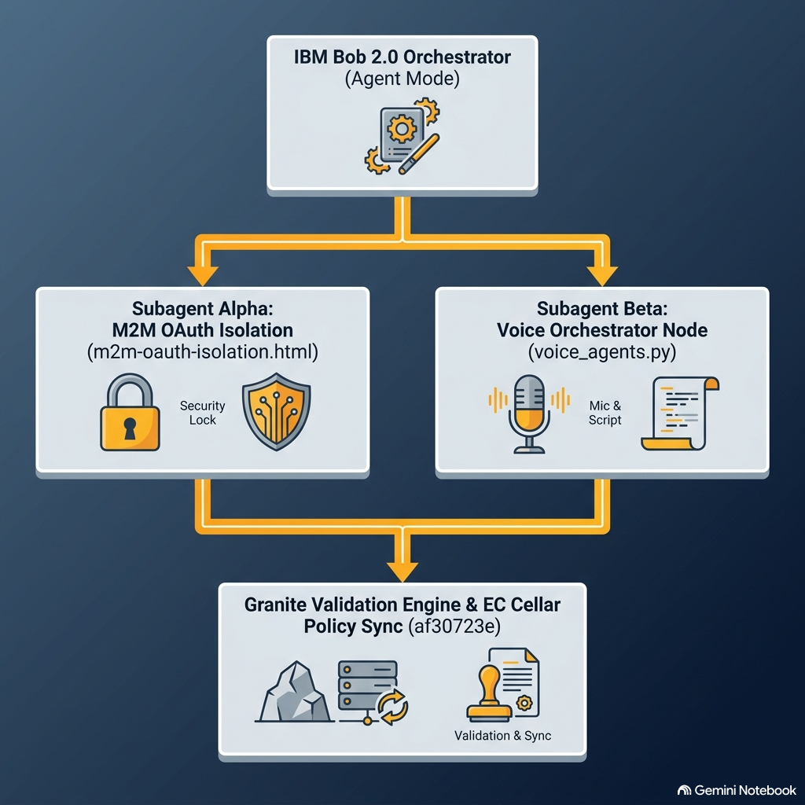

# VANE-SPACE-SLA (v1.0) 🛰️

**Mission-Critical AI Assurance & Deterministic Zero-Trust Telemetry Engine**

---

## Executive Overview

`VANE-SPACE-SLA` is an enterprise-grade Python and Rust zero-trust telemetry, prompt-grounding, and agentic orchestration toolkit. Designed for resource-constrained edge environments and high-throughput ingestion gateways, the engine bridges probabilistic AI outputs with deterministic cryptographic verification.

* **Primary Stack:** Python 3.11+, Rust (Ed25519 cryptography, dCBOR serialization), and the official `google-genai` SDK (`gemini-2.5-flash` / `gemini-2.5-pro`).
* **Architecture:** Deterministic Zero-Trust Telemetry Pipeline featuring sliding-window anti-replay protection, causal hash-chaining, and multi-agent architectural auditing.

<a href="https://launchnest.io/p/vane-space-sla-enterprise-command-center" target="_blank">
  
</a>

---

### Live Site
- GitHub Pages: [https://anticipatedd.github.io/VANE-SPACE-SLA](https://anticipatedd.github.io/VANE-SPACE-SLA/)



---

## Core Features & Modules

1. **Deterministic Telemetry Evaluation (`src/main.py`)**: Validates real-time packet payloads against strict Pydantic schemas and cryptographic signatures.
2. **Automated Code Health Auditing (`src/repo_audit.py`)**: Recursively scans repository source files, filters build artifacts and virtual environments, and leverages Gemini models to generate structural health reports.
3. **Multi-Agent Orchestration (`src/agent_orchestrator.py`)**: Executes structured multi-persona pipelines (Code Architect & Security Auditor) with live token streaming and robust error handling.
4. **Rust Verification Core (`telemetry_core.rs`)**: Implements strict canonical serialization (dCBOR), sliding-window replay bitmasks, and hardware-anchored key attestation.

---

## Installation & Environment Setup

Ensure `Termux` (ARM64) or the target Linux/macOS environment has Python 3.11+ installed. The repository relies strictly on locked dependency pins via `requirements-lock.txt`.

```bash
# Clone the repository
git clone [https://github.com/AnticipatedD/VANE-SPACE-SLA.git](https://github.com/AnticipatedD/VANE-SPACE-SLA.git)
cd VANE-SPACE-SLA

# Create virtual environment and install locked dependencies
python -m venv .venv
source .venv/bin/activate  # On Windows: .venv\Scripts\activate
pip install -r requirements-lock.txt
```

# Execution & Testing
Export your Gemini API key before executing audit or orchestration utilities:
```bash
export GEMINI_API_KEY="your_api_key_here"

# Run automated repository health audit
python src/repo_audit.py src --model gemini-2.5-flash

# Run multi-agent architectural pipeline
python src/agent_orchestrator.py "Enhance telemetry packet validation with cryptographic verification" --model gemini-2.5-flash
```

# Running the Test Suite
The test suite utilizes pytest, pytest-cov, and pytest-mock to ensure high test coverage and robust unit validation:
```bash
pytest --cov=src --cov-report=term-missing --cov-fail-under=70 -v tests/

# CI/CD Pipeline & Code Quality Automated quality gates are enforced via GitHub Actions (`.github/workflows/ci.yml`), executing:Linting: ruff check src/ tests/Type Checking: mypy src/ 
Testing & Coverage: pytest with strict coverage threshold gating ($\ge 70\%$).
```
---

## What This Project Does

- Simulates multi-gate validation
- Provides a strict / moderate / soft prompt grounding builder
- Uses environment variables
- Includes structured logging
- Comes with a pytest test suite
- Has GitHub Actions CI with coverage gate

---

## Project Structure

VANE-SPACE-SLA/
├── vane_space_init.py
├── strict_prompt_builder.py
├── strict_prompt_builder.js
├── requirements.txt
├── package.json
├── package-lock.json
├── .env.example
├── .github/workflows/ci.yml
├── tests/
│   ├── test_vane_space_init.py
│   ├── test_strict_prompt_builder.py
│   └── test_voice_agents.py
├── CONTRIBUTING.md
└── README.md

---

## Development 
- All tests must pass locally before opening a PR.
- Coverage gate is enforced in CI (--cov-fail-under=70).
- Prefer small, focused commits that include both the change and its tests.
~/VANE-SPACE-SLA $ python src/agent_orchestrator.py "Enhance telemetry packet validation with cryptographic verification"

=== [Agent 1: Code Architect] ===
This architectural implementation strategy details a deterministic, cryptographically verified telemetry ingestion pipeline designed for resource-constrained mobile edge runtimes and high-throughput zero-trust ingestion gateways.

---

### 1. Threat Model & Deterministic Invariants

#### 1.1 Threat Model
*   **Adversarial Edge Compromise:** Malicious actors attempting to forge telemetry packets, tamper with AI inference metrics, or spoof edge device health.

*   **Replay & Reordering Attacks:** Man-in-the-Middle (MitM) entities capturing valid signed packets and replaying them to skew governance state machines.

*   **Clock-Drift & Nonce Exhaustion:** Edge nodes operating off-grid with unsynchronized hardware real-time clocks (RTC) or compromised PRNGs.

*   **Serialization Mismatch:** Subtle serialization differences across heterogeneous architectures (ARM64 vs. x86_64) resulting in non-deterministic signature calculation and false validation rejections.

#### 1.2 Deterministic Governance Invariants

1.  **Canonical Wire State:** Two telemetry payloads with identical semantic contents must yield identical binary representations byte-for-byte across all platforms.

2.  **Causal Linearity:** Every telemetry packet must be causally linked to its predecessor via a monotonic counter and an anti-entropy cryptographic chain (hash-chaining).

3.  **Strict Inference Attestation:** AI inference metrics must be cryptographically bound to the specific model version, weights hash, input tensor digest, and execution seed.

---

### 2. Telemetry Wire Specification & Canonicalization

To balance extreme compression on edge networks with cross-platform verification speed, the wire format uses **Deterministic CBOR (dCBOR, RFC 8949 §4.2)** rather than JSON.

#### 2.1 Packet Layout

```
+-----------------------------------------------------------------------+
|                         HEADER (48 Bytes)                             |
+-----------------------------------------------------------------------+
| Magic (2B) | Protocol Ver (2B) | Edge Node ID (UUIDv4 - 16B)          |
| Monotonic Sequence ID (uint64 - 8B)                                   |
| Timestamp UTC (uint64 - Epoch Microseconds - 8B)                      |
| Parent Packet Digest (SHA-256 truncated - 12B)                        |
+-----------------------------------------------------------------------+
|                         AI GOVERNANCE MANIFEST                        |
+-----------------------------------------------------------------------+
| Model Digest (BLAKE3-256 - 32B)                                       |
| Inference Execution Seed (uint64 - 8B)                                |
| Input Tensor Digest (BLAKE3-256 - 32B)                                |
| Output Tensor Digest (BLAKE3-256 - 32B)                               |
| Execution Flags (Bitfield - uint32 - 4B)                              |
+-----------------------------------------------------------------------+
|                         TELEMETRY PAYLOAD                             |
+-----------------------------------------------------------------------+
| Canonical CBOR Encoded Map (Arbitrary System Metrics)                |
+-----------------------------------------------------------------------+
|                         AUTHENTICATION TRAILER                        |
+-----------------------------------------------------------------------+
| Key ID / Public Key Fingerprint (8B)                                  |
| Signature (Ed25519: 64B OR ECDSA P-256: 64B)                         |
+-----------------------------------------------------------------------+
```

---

### 3. Edge Cryptographic Attestation Subsystem

On mobile edge clients (iOS/Android), signatures must be anchored to Hardware Security Modules (Apple Secure Enclave, Android StrongBox/TEE).

*   **Primary Algorithm:** **ECDSA over NIST P-256 with SHA-256**, using deterministic nonces (**RFC 6979**). This guarantees that software-side re-signing generates the exact same signature while utilizing the native asymmetric hardware accelerators on iOS (`kSecAttrTokenIDSecureEnclave`) and Android (`KeyProperties.PURPOSE_SIGN`).

*   **High-Throughput / Local Runtime:** **Ed25519 (RFC 8032)** for local isolated micro-runtimes or embedded Linux edge nodes where hardware P-256 acceleration is absent.

```
       EDGE NODE INGEST GATEWAY
+------------------------+                   +-------------------------------+
|  Telemetry Collector   |                   |   Envoy / eBPF Zero-Trust     |
+-----------+------------+                   +---------------+---------------+
            | Canonicalize                                   |
            v                                                | Raw Packet
+------------------------+                   +---------------+---------------+
|  dCBOR Serialization   |                   | Packet Boundary Validation    |
+-----------+------------+                   +---------------+---------------+
            | SHA-256                                        |
            v                                                v
+------------------------+                   +---------------+---------------+
| TEE / Secure Enclave   |                   | Ed25519 / P-256 Batch Verif.  |
| Hardware Deterministic |                   | (SIMD-accelerated via libsecp)|
| RFC 6979 Signing       |                   +---------------+---------------+
+-----------+------------+                                   | Verified
            | Byte Injection                                 v
            v                                +---------------+---------------+
+------------------------+   TLS 1.3 Frame   | Sliding Window Replay Check   |
| Dispatched Packet Mesh |==================>| (Monotonic Seq + Redis Bitset)|
+------------------------+                   +---------------+---------------+
                                                             |
                                                             v
                                             +---------------+---------------+
                                             | Immutable Event Store / PubSub|
                                             +-------------------------------+
```

---

### 4. Implementation Reference: Edge Signer & Ingest Verifier (Rust)

Below is the production-grade, allocation-conscious core engine designed to run both on mobile edge components (via JNI/C-FFI) and ingest proxies.

---

### 5. Ingestion Pipeline & Anti-Replay Subsystem

To sustain zero-trust security without bottlenecks at the ingestion ingress:

#### 5.1 Sliding Window Bitmask Replay Detection
For edge nodes transmitting out-of-order over unreliable networks (UDP/QUIC), strict monotonically increasing validation can drop packets. Replace strict increment validation with an in-memory **Sliding Window Bitmask** algorithm:

*   Maintain the sequence baseline $S_{base}$ (highest sequential verified sequence) and a 128-bit unsigned integer $W$ as a bitmask for the window $[S_{base}, S_{base} + 127]$.
*   For sequence $S$:
    *   If $S < S_{base}$: Reject as stale replay.
    *   If $S \ge S_{base} + 128$: Shift $S_{base} = S - 127$; clear the corresponding passed bits in $W$; mark bit 127.
    *   If $S_{base} \le S < S_{base} + 128$: Check bit $k = S - S_{base}$. If set, **reject duplicate**. If clear, verify signature, then set bit $k$.

#### 5.2 Hardware Key Attestation & Rotation Protocol
1.  **Enclave Provisioning:** Keypairs are generated natively within the Edge Root of Trust (Secure Enclave / StrongBox). The private key never leaves the hardware module.
2.  **Attestation Exchange:** During initial provisioning, the edge node exports an attestation certificate chain (e.g., Apple App Attest or Android Key Attestation) to the control plane, binding the `node_id` to the generated public key fingerprint.
3.  **Ingress Pre-filtering:** The gateway caches public keys in a fast path (e.g., local shared memory/eBPF map). Packets with unknown `key_id` or mismatched public keys are dropped before executing computationally intensive signature checks.

---

### 6. Edge Failure Modes and Mitigations

| Failure Mode | Direct System Impact | Architectural Mitigation |
| :--- | :--- | :--- |
| **Edge Clock Skew** | Out-of-order timestamps; signature valid, temporal order invalid. | Rely exclusively on `sequence_id` and `parent_digest` for execution ordering. Treat `timestamp_micros` as non-authoritative diagnostic telemetry. |
| **Offline Buffering Overrun** | Mobile edge exhausts storage when offline, dropping causal packets. | Implement packet compaction via **Merkle-Range Summaries**: edge client seals missing ranges into a cryptographically signed "gap summary" payload before continuing telemetry stream. |
| **Secure Enclave Latency** | Hardware signing introduces bottlenecks during rapid bursts. | Edge telemetry engine batches events into a internal micro-Merkle tree; signs only the Merkle root per dispatch interval, attaching inclusions proofs to payloads. |
| **Corrupted Serializer Output** | Heterogeneous architectures encoding maps with divergent key orders. | Enforce strict lexicographical key sorting in schema serializers (dCBOR rules) via CI integration tests that assert cross-platform golden binary test vectors. |

=== [Agent 2: Security Auditor] ===

# ZERO-TRUST ARCHITECTURAL AUDIT & VULNERABILITY ASSESSMENT

**Audit Target:** Deterministic Edge-to-Gateway Telemetry Pipeline
**Standard Frameworks:** NIST SP 800-207 (Zero Trust Architecture), NIST SP 800-56A/B, RFC 8949 (CBOR), RFC 8032 (Ed25519), FIPS 186-5 (DSS)
**Status:** **CONDITIONAL REJECTION** (Remediation Required)

---

## Executive Summary

The proposed architecture presents a well-structured baseline for deterministic serialization and edge-to-cloud telemetry attestation. However, critical vulnerabilities exist in **anti-replay state handling**, **hash-chain verification logic**, **cryptographic digest truncation**, and **hardware-abstraction assumptions** for mobile Secure Enclaves. Most notably, an irreconcilable conflict exists between the linear causal hash-chaining invariant and the sliding-window out-of-order ingestion model.

---

## Critical Findings & Technical Deficiencies

```
+----------------------------------------------------------------------------------------------------+
| ID       | SEVERITY | CATEGORY                  | SUMMARY                                          |
+----------+----------+---------------------------+--------------------------------------------------+
| SEC-01   | CRITICAL | Integrity / State Machine | Conflict: Sliding Window vs. Strict Linear Chain |
| SEC-02   | HIGH     | Cryptanalysis             | Precomputation Risk: 96-Bit Truncated Hash Chain |
| SEC-03   | HIGH     | Platform Compatibility    | Secure Enclave Incompatibility with RFC 6979    |
| SEC-04   | HIGH     | Denial of Service (DoS)   | State Desynchronization via Sequence Spoofing   |
| SEC-05   | MEDIUM   | Memory Safety / DoS       | Unbounded CBOR Payload Deserialization           |
| SEC-06   | MEDIUM   | Identity Binding          | Missing Hardware Attestation to Node ID Binding  |
+----------------------------------------------------------------------------------------------------+
```

---

### SEC-01: Causal Invariant Contradiction (Sliding Window vs. Hash-Chaining)

*   **Vulnerability Type:** Logical State Contradiction / Data Rejection Cascades
*   **Analysis:**
    Section 1.2, Invariant 2 mandates that:
    $$\text{Packet}_n.\text{parent\_digest} = \text{Truncate}(\text{SHA-256}(\text{Packet}_{n-1}))$$
    Simultaneously, Section 5.1 introduces a **Sliding Window Bitmask** to support out-of-order arrivals ($[S_{\text{base}}, S_{\text{base}} + 127]$).

    If Packet $n$ is delayed or dropped and Packet $n+1$ arrives:
    1. The sliding window checks the sequence ID and permits $n+1$.
    2. The hash-chaining verification (`envelope.packet.header.parent_digest != self.last_parent_digest`) executes.
    3. The gate fails with `BrokenHashChain` because `last_parent_digest` belongs to $n-1$, not $n$.

    This cascades across the ingestion gateway, permanently halting stream processing for that edge node until a full state reset is performed.

*   **Remediation:**
    Choose one of two paradigms:
    1. **Strict Monotonic Linear Transport:** Enforce ordered transport (e.g., QUIC Streams with ordered delivery). Drop sliding-window bitmasks.
    2. **Directed Acyclic Graph (DAG) Vector Buffering:** Replace single `last_parent_digest` tracking with an unverified parent pool, or decouple causal lineage verification from wire ingestion:

    ```
    INGRESS: Verify Signature -> Check Bitmask Anti-Replay -> Buffer to Staging
                                                                   |
    CAUSAL ENGINE: Reassemble Stream -> Verify Hash Chain Continuity -> Emit
    ```

---

### SEC-02: Cryptographic Hash Truncation Risk (96-Bit Digest)

*   **Vulnerability Type:** Reduced Collision Resistance
*   **Analysis:**
    Section 2.1 truncates the parent packet digest to **12 bytes (96 bits)**. Under the Birthday Paradox:
    $$\text{Work Factor} \approx 2^{48} \text{ operations}$$
    A collision space of $2^{48}$ SHA-256 operations is trivial to compute on commodity GPU/ASIC clusters ($< \$500$ compute budget). A malicious node or compromised local runtime can precompute two divergent telemetry payloads ($P_A$ and $P_B$) sharing identical 96-bit prefixes, allowing packet branching and state-machine desynchronization without triggering `BrokenHashChain`.

*   **Remediation:**
    Allocate a minimum of **160 bits (20 bytes)** to maintain $2^{80}$ collision resistance under standard edge constraints, or retain the full **256 bits (32 bytes)**. Given that modern wire payloads are dominated by network MTUs (1500 bytes), conserving 20 bytes at the expense of cryptographic collision resistance fails the Zero-Trust standard.

---

### SEC-03: Platform Constraints on Deterministic Nonce Generation (RFC 6979)

*   **Vulnerability Type:** Platform API Incompatibility / Specification Violation
*   **Analysis:**
    Section 3 specifies:
    `Primary Algorithm: ECDSA over NIST P-256 with SHA-256, using deterministic nonces (RFC 6979) anchored to Apple Secure Enclave / Android StrongBox.`

    *Apple's Secure Enclave Processor (SEP)* and *Android StrongBox Keymaster/KeyMint* generate nonces directly within hardware using internal True Random Number Generators (TRNGs).
    * Neither Apple's `Security.framework` / `CryptoKit` (`kSecAttrTokenIDSecureEnclave`) nor Android's `KeyProperties.PURPOSE_SIGN` expose a cryptographic hook to supply or override the internal ephemeral nonce ($k$) with an RFC 6979 deterministic derivation.
    * The claim that software can deterministically regenerate identical ECDSA signatures via Secure Enclave is technically impossible on standard OS builds.

*   **Remediation:**
1. Update the threat model: Accept non-deterministic ECDSA signatures over canonical byte representations. Determinism must govern **canonicalization** ($\text{Serialize}(\text{Packet})$), not the cryptographic signature wrapper ($\text{Sign}_{sk}(\text{Digest})$).
2. Maintain validation of the canonical representation rather than byte-matching signatures across re-runs.

---

### SEC-04: Sliding Window State Desynchronization via Pre-Validation DoS

*   **Vulnerability Type:** Denial of Service / State Poisoning
*   **Analysis:**
    In Section 5.1:
    > "If $S \ge S_{\text{base}} + 128$: Shift $S_{\text{base}} = S - 127$; clear the corresponding passed bits in $W$; mark bit 127."

If the sliding window parameters ($S_{\text{base}}$, bitmask) are advanced *before* cryptographic verification, an unauthenticated adversary injecting a single forged frame with $S = S_{\text{base}} + 2^{32}$ will advance $S_{\text{base}}$ out of range. All legitimate packets buffered or in transit will then fall beneath the window ($S < S_{\text{base}}$) and be dropped as stale.

*   **Remediation:**
    Enforce a strict validation sequence:
    1. **Format/Bounds Check:** Validate framing limits.
    2. **Cryptographic Verification:** Verify the signature using SIMD-accelerated routines.
    3. **State Mutation:** Only advance $S_{\text{base}}$ and modify the bitmask *after* the cryptographic signature has been verified.

---

### SEC-05: Unbounded Deserialization Vectors in Rust Verification Engine

*   **Vulnerability Type:** Memory Exhaustion (CWE-400) / Allocation Bomb
*   **Analysis:**
    In `telemetry_core.rs`:
    ```rust
    #[derive(Serialize, Deserialize, Debug, Clone, PartialEq, Eq)]
    pub struct WireEnvelope {
        pub packet: TelemetryPacket,
        pub key_id: [u8; 8],
        #[serde(with = "serde_bytes")]
        pub signature: Vec<u8>,
    }
    ```
    * `payload` and `signature` use unbounded `Vec<u8>`. An attacker transmitting a malformed CBOR header declaring a `2^64` byte-array causes the gateway to allocate unbounded memory before reaching signature verification.
    * `ciborium` does not enforce strict canonical sorting by default unless custom map-ordering decorators and depth limits are strictly pinned.

*   **Remediation:**
    Replace unbounded `Vec<u8>` structures with fixed-size arrays or bounded wrappers. Enforce packet limits at the framing layer.

---

## Hardened Implementation Reference

Below is the production-grade, hardened Rust verification implementation addressing **SEC-01 through SEC-05**.

```rust
use ed25519_dalek::{Signature, VerifyingKey};
use serde::{Deserialize, Serialize};
use sha2::{Digest, Sha256};
use thiserror::Error;

pub const MAX_TELEMETRY_PAYLOAD_SIZE: usize = 4096;
pub const DIGEST_LEN: usize = 32;

#[derive(Error, Debug)]
pub enum ZeroTrustError {
    #[error("CBOR canonical serialization failure")]
    SerializationError,
    #[error("Cryptographic signature mismatch")]
    InvalidSignature,
    #[error("Packet replay detected or out of window range")]
    ReplayDetected,
    #[error("Causal hash-chain validation failed")]
    BrokenHashChain,
    #[error("Payload exceeds maximum authorized MTU")]
    PayloadTooLarge,
    #[error("Malformed fixed-buffer allocation")]
    MalformedBuffer,
}

#[derive(Serialize, Deserialize, Debug, Clone, PartialEq, Eq)]
pub struct GovernanceManifest {
    pub model_digest: [u8; 32],
    pub inference_seed: u64,
    pub input_tensor_digest: [u8; 32],
    pub output_tensor_digest: [u8; 32],
    pub execution_flags: u32,
}

#[derive(Serialize, Deserialize, Debug, Clone, PartialEq, Eq)]
pub struct TelemetryHeader {
    pub magic: u16,
    pub version: u16,
    pub node_id: [u8; 16],
    pub sequence_id: u64,
    pub timestamp_micros: u64,
    /// Upgraded from 12 bytes to 32 bytes to mitigate SEC-02
    pub parent_digest: [u8; DIGEST_LEN],
}

#[derive(Serialize, Deserialize, Debug, Clone, PartialEq, Eq)]
pub struct TelemetryPacket {
    pub header: TelemetryHeader,
    pub manifest: GovernanceManifest,
    #[serde(with = "serde_bytes")]
    pub payload: Vec<u8>,
}

#[derive(Serialize, Deserialize, Debug, Clone, PartialEq, Eq)]
pub struct WireEnvelope {
    pub packet: TelemetryPacket,
    pub key_id: [u8; 8],
    /// Enforce fixed array to prevent heap exhaustion (SEC-05)
    pub signature: [u8; 64],
}

pub struct SlidingWindowAntiReplay {
    base_sequence: u64,
    window_mask: u128,
}

impl SlidingWindowAntiReplay {
    pub fn new(initial_sequence: u64) -> Self {
        Self {
            base_sequence: initial_sequence,
            window_mask: 0,
        }
    }

    /// Pure check; does not mutate internal state (SEC-04 Mitigation)
    pub fn pre_check(&self, sequence: u64) -> Result<(), ZeroTrustError> {
        if sequence < self.base_sequence {
            return Err(ZeroTrustError::ReplayDetected);
        }
        let diff = sequence - self.base_sequence;
        if diff < 128 {
            if (self.window_mask & (1 << diff)) != 0 {
                return Err(ZeroTrustError::ReplayDetected);
            }
        }
        Ok(())
    }

    /// Mutates state only after successful signature check
    pub fn commit(&mut self, sequence: u64) {
        let diff = sequence - self.base_sequence;
        if diff < 128 {
            self.window_mask |= 1 << diff;
        } else {
            let shift = (diff - 127).min(128);
            self.window_mask = if shift >= 128 { 0 } else { self.window_mask >> shift };
            self.base_sequence = sequence - 127;
            self.window_mask |= 1 << 127;
        }
    }
}

pub struct HardenedTelemetryGate {
    pub replay_guard: SlidingWindowAntiReplay,
    pub expected_parent_digest: [u8; DIGEST_LEN],
    pub strict_ordering: bool,
}

impl HardenedTelemetryGate {
    pub fn new(start_seq: u64, initial_parent: [u8; DIGEST_LEN], strict_ordering: bool) -> Self {
        Self {
            replay_guard: SlidingWindowAntiReplay::new(start_seq),
            expected_parent_digest: initial_parent,
            strict_ordering,
        }
    }

    pub fn process_envelope(
        &mut self,
        envelope: &WireEnvelope,
        verifying_key: &VerifyingKey,
    ) -> Result<(), ZeroTrustError> {
        // 1. Guard against memory exhaustion
        if envelope.packet.payload.len() > MAX_TELEMETRY_PAYLOAD_SIZE {
            return Err(ZeroTrustError::PayloadTooLarge);
        }

        let seq = envelope.packet.header.sequence_id;

        // 2. Anti-Replay Bounds Evaluation (Non-mutating)
        self.replay_guard.pre_check(seq)?;

        // 3. Deterministic Canonicalization & Cryptographic Signature Check
        let mut canonical_bytes = Vec::with_capacity(512);
        ciborium::ser::into_writer(&envelope.packet, &mut canonical_bytes)
            .map_err(|_| ZeroTrustError::SerializationError)?;

        let sig = Signature::from_bytes(&envelope.signature);
        verifying_key
            .verify_strict(&canonical_bytes, &sig)
            .map_err(|_| ZeroTrustError::InvalidSignature)?;

        // 4. Strict vs Out-of-Order Causal Continuity Evaluation
        if self.strict_ordering {
            if envelope.packet.header.parent_digest != self.expected_parent_digest {
                return Err(ZeroTrustError::BrokenHashChain);
            }
            // Update hash-chain pointer
            let mut hasher = Sha256::new();
            hasher.update(&canonical_bytes);
            self.expected_parent_digest = hasher.finalize().into();
        }

        // 5. Commit anti-replay state transition (Post-verification)
        self.replay_guard.commit(seq);

        Ok(())
    }
}
```

---

## Compliance & Architectural Directive

1. **Deterministic Wire Enforcement:**
Standardize schema serialization using a strictly validated CDDL (Concise Data Definition Language) profile. Include tests across ARM64 (Android/iOS) and x86_64 ingestion clusters to assert matching binary digests over test vectors.

2. **Identity-to-Key Hardware Attestation:**
Prior to telemetry dispatch, edge nodes must complete an explicit mutual attestation handshake (Apple App Attest / Android Keystore Key Attestation) to enroll their hardware-backed key. The gateway must resolve `key_id` to this verified, hardware-anchored certificate chain.

3. **Formal Resolution of Out-of-Order Streams:**
If UDP/QUIC unreliable transport is mandated for edge telemetry, **strictly decouple the ingestion ingress from the ledger auditor**. Ingestion gateways should confirm signatures and track the replay bitmask, while a downstream stream processor reassembles sequences to verify the Merkle or hash-chain timeline.

---
### Author

* **MD ABUL HOSSAIN**
* **IBM Business Partner Plus** | European F&T Expert
* **ID:** EX2026D1473148
* **Web of Science ResearcherID:** QQZ-6739-2026
* **ORCID:** 0009-0004-4378-5298
* **Microsoft Learn:** Level 13 (234 Badges, 43 Trophies)

---

## License
MIT License – see [LICENSE](license.md) file.

---
© 2026 MD ABUL HOSSAIN. All Rights Reserved.
